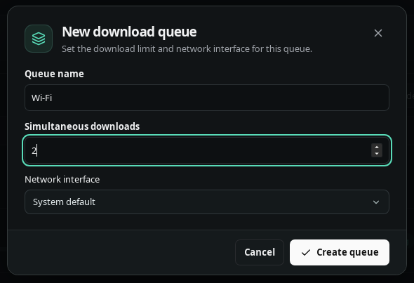
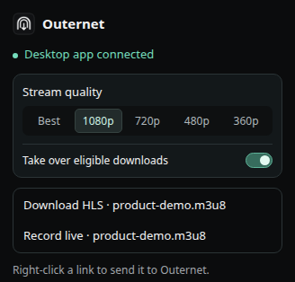

# Outernet Download Manager

Outernet downloads HTTP(S) files and supported on-demand video streams on Linux
and Windows. Its local queue, settings, and history use SQLite.

## Screenshots






## Install and run

Get the x86-64 desktop installer and browser extension from the
[Desktop builds workflow](https://github.com/alimohammad0816/outernet_download_manager/actions/workflows/build.yml)
or the matching [GitHub Release](https://github.com/alimohammad0816/outernet_download_manager/releases).
The installers bundle yt-dlp and Node.js. Windows also bundles FFmpeg and
ffprobe. The Linux `.deb` declares FFmpeg as a package dependency.

For development, install Node.js 24, stable Rust, CMake, the
[Tauri prerequisites](https://v2.tauri.app/start/prerequisites/). Local
development builds use the tools on PATH unless built with the packaged engines.

```sh
npm ci
npm run tauri dev
```

## Connect a browser

1. For Chrome, Edge, or Chromium, extract `outernet-browser-extension.zip`,
   open the Extensions page, turn on Developer mode, and choose **Load unpacked**.
   When working from source, you can select the `browser/` folder directly.
2. For Firefox, extract `outernet-firefox-extension.zip`. Open
   `about:debugging#/runtime/this-firefox`, choose **Load Temporary Add-on**,
   and select the extracted `manifest.json`. Reload the temporary add-on after
   restarting Firefox.
3. In Outernet, open **Browser integration** and select your browser to
   register the desktop connection for your account. Open the extension popup
   to check the connection.

Right-click a link and choose **Download with Outernet**. On pages with a
supported video source, use **Download this video** beside the player. The
extension popup lists direct video responses and HLS/DASH manifests detected
in the active tab. For HLS and DASH, choose the quality for this download
beside the player, or set the default from the extension popup. Outernet
picks the best quality up to the preference where offered, or the lowest
known resolution above it.

For a direct file behind a sign-in, use **Download with Outernet using site
session**. The browser makes the authenticated request and streams the body
to the configured in-progress folder through Native Messaging. Site cookies
stay in the browser. This mode requires a full response with a known byte
length and an unencoded body. It uses the browser's regular profile session
and supports direct files. Websites that issue a POST, require a page-issued
authorization header, or serve protected segmented media still use the
browser's normal download flow.

Enable **Automatically take over eligible downloads** in the extension popup
to transfer matching browser downloads. This covers attachment GETs of at
least 1 MiB with an allowed extension, a strong ETag, and matching length and
media type. Outernet validates the second response before pausing the original,
and the extension cancels the original only after the desktop confirms that
the complete body is durably queued. If the handoff fails, the extension
resumes the original when the browser can resume it.

Video support covers finished HLS with discrete segments or byte ranges and
static single-period DASH with fragmented MP4 SegmentTemplates. HLS byte
ranges require a strong ETag and matching range responses. Finished HLS also
supports standard AES-128 with identity keys served by the site, including
explicit IVs and key rotation. The AES-128 path supports complete segments.
DRM and SAMPLE-AES require a different playback path.

For a compatible live HLS stream, choose **Record live in Outernet** next to
the video or **Record live** in the popup. Use **Stop and save recording** in
the desktop queue to finalize the captured portion. Live recording supports
unencrypted, multiplexed streams with discrete MPEG-TS segments. It retries
temporary failures while the segments remain available and fails if the
server window advances past a missing segment. The output is Matroska
(`.mkv`).

YouTube watch and Shorts links can be sent from the extension's video button
or popup, and pasted into the desktop app. Outernet uses its bundled
[yt-dlp](https://github.com/yt-dlp/yt-dlp) with Node.js for public on-demand
videos. It uses the configured in-progress folder for both media tracks before merging
and verifying the MKV.

## Manage downloads

**Add download** and direct links sent by the browser extension open a separate
window. Choose a download queue and destination folder, which starts with the
default from Settings. **Download now** starts a transfer as soon as the chosen
queue has an available slot. **Download later** saves the item until the queue
is started or you explicitly start that item. The same window shows progress
and gives you **Open file**, **Open folder**, and **Close** when finished.
Use **Add multiple links** for a batch. When you send a link using the browser
session option, the browser first passes the verified response to Outernet.

Double-click a completed download to open it with your system's default app.
Right-click a row or use its **More actions** button for **Show in folder**,
**Properties** and the actions available for that download. **Remove from list**
stops an active transfer and removes its working files. It keeps any completed
file on disk.

In **Add download**, select **Multiple links** and paste one URL per line
(up to 500). Check the file preview, then queue the links. Outernet validates
the batch before committing it to the queue.
Existing and conflicting filenames receive a numbered suffix. Use **File type**
to filter downloads by filename extension.

Use **Replace link** on an incomplete failed or paused download. The queue
keeps its filename, destination, priority, and existing publisher checksum.
When the URL changes, Outernet reuses verified byte ranges only if the
publisher SHA-256 is known and the remote size and strong ETag match. The
complete file must still match the publisher checksum before publication.

## Schedule the queue

Open **Queue schedule** to hold the queue until a local date and time, allow
new transfers only during a daily time window, or combine both. A daily
window can cross midnight. Schedules survive app restarts. **Clear schedule**
releases the queue. Active transfers and publication of already received files
continue outside the window.

Use the queue selector to switch queues. **New queue** creates a stopped queue,
and **Queue settings** sets its name, network interface, and simultaneous
download limit. Existing downloads migrate to **Main queue**. Use **Start queue**
and **Stop queue** to control the selected queue. A stopped file transfer goes
back to its queue and resumes from verified ranges when available. Stopping
a queue finalizes its active live recordings.

**System default** follows the system route. A selected interface is resolved
at the start of each transfer. Outernet binds HTTP transfers to its source IP
and also to the adapter on Linux. YouTube transfers use the selected source
IP through yt-dlp. The system manages routing and DNS. Browser-assisted
transfers that Chrome or Firefox fetch themselves use the browser's own
network route. The single-download popup lets you choose the queue for a link sent from the extension.

Under **Settings → Network → Proxy**, select **System proxy**, **Direct**, or
**Custom**. System mode follows proxy environment variables and manual proxy
settings from Windows or GNOME on Linux. Custom mode accepts HTTP, HTTPS,
SOCKS5 and SOCKS5h URLs without credentials, for example
`socks5h://127.0.0.1:1080`. Changes apply when Outernet starts the next transfer.
On a queue with a selected interface, Outernet connects to the proxy through
that interface's source address. Browser-assisted transfers use browser
settings. Automatic PAC scripts are unsupported.

In **Add download** choose the destination queue, or use **Move to queue** in
a row's action menu. Sort the list by date added, name, size, status or priority.
New downloads start in priority order within the global schedule, with older
jobs first among equal priorities. Lowering the limit lets active downloads
finish before more start.

Enable **Keep running in the system tray when closed** to let the queue progress
after closing the window. Open Outernet from the tray or launch it again to
restore the window. **Quit Outernet** in the tray exits the application.
**Notify me when a download completes** sends an OS notification once the
verified file has been published. The operating system controls notification
visibility, and Linux desktops need a system-tray host to display the tray icon.

## Storage and integrity

Choose separate **In-progress folder** and **Completed downloads folder** paths
in **Settings**. Place the first folder on an HDD to keep transfer data and
video assembly on that disk. An SSD selected as the final destination receives
the completed file once. If the in-progress folder is unavailable, reconnect
the disk and use **Retry**. Folder changes apply to new downloads.

Outernet requests up to four ranges in parallel when a large file advertises
byte ranges and a strong ETag. Every range must match the requested byte
positions and the same strong ETag. After pause or interruption, Outernet
checks the source identity and the SHA-256 of each saved part before reusing
it. If the resource changes or declines the range request, the app starts a
fresh single-connection transfer. Single-connection transfers and video
assembly restart from the beginning after interruption.

The list shows live progress, speed and an estimated remaining time for active
desktop transfers with a known size. Transfers without a known total still
show the received bytes and speed. In **Settings**, enter a speed limit per
download in KiB/s, or leave it blank for unlimited speed. The limit is read
when a transfer starts and shared by its parallel connections. Browser-assisted
transfers use the configured limit when the matching extension is installed.

An optional publisher SHA-256 can be entered when adding a direct link.
Outernet compares the result with that reference before publication. For
video, it requires all listed segments, checks output duration, and decodes
the assembled audio and video before publishing the file. It verifies copied
bytes before publishing across filesystems. If publication fails after a
successful transfer, **Retry** reuses the verified working file.

## Tests and builds

```sh
npm run build
npm run check:extension
npm run test:extension
cargo test --locked --manifest-path src-tauri/Cargo.toml
cargo test --release --locked --manifest-path src-tauri/Cargo.toml --test download_integrity downloads_over_four_gib -- --ignored --exact
```

The tests use loopback fixtures and require FFmpeg and ffprobe. To test a
cross-filesystem copy of the large fixture, set `OUTERNET_TEST_DESTINATION` to
a directory on a different volume from the system temporary directory. Both
volumes need more than 4 GiB free.

GitHub Actions builds x86-64 installers on Ubuntu 24.04 and Windows Server
2025 and packages both browser extensions. Pushing a version tag that matches
`src-tauri/tauri.conf.json` runs the large-file test before publishing a GitHub Release with the two
installers, the two browser extensions, and a SHA-256 checksum file.

## Updates

Outernet checks GitHub Releases at launch and every six hours while it is open.
When a newer stable release is available, the title bar displays **Update
available**. You can also check manually under **Settings → Updates**.
Signed builds with a matching release manifest can install updates from that
panel when the download workers are idle. Other builds open the official
GitHub release so you can download and install the package manually.

## Signing and store distribution

Tagged builds can enable updater signatures for Windows and Debian, plus an independent Authenticode signature for Windows.

| GitHub setting | Value |
| --- | --- |
| Repository variable `OUTERNET_UPDATER_PUBLIC_KEY` | Contents of the `.pub` file generated by the Tauri signer. |
| Secret `TAURI_SIGNING_PRIVATE_KEY` | Contents of the corresponding private key file. |
| Secret `TAURI_SIGNING_PRIVATE_KEY_PASSWORD` | The password for the private key, when set. |
| Secret `WINDOWS_CERTIFICATE` | Base64-encoded, exportable Authenticode PFX with a trusted code-signing chain. |
| Secret `WINDOWS_CERTIFICATE_PASSWORD` | Password for the PFX. |

Generate updater keys with `npm run tauri -- signer generate --write-keys /secure/path/outernet.key`.
Keep a secure backup of the private key outside the repository. Keep the same
updater key across releases so installed copies can verify future updates.
A configured updater build includes the public key and the GitHub release
endpoint. GitHub Actions verifies both installer signatures before publishing
`latest.json`. Install the first updater-enabled build manually. Installing a
Debian update may require operating-system authorization. See the
[Tauri updater setup](https://v2.tauri.app/plugin/updater/).

The Windows workflow imports the PFX into the runner's user certificate store
and verifies the timestamp and Authenticode signature on both the app executable
and the installer. A hardware-backed or remote signing provider requires its own
Tauri signing command and runner configuration.
[Windows signing in Tauri](https://v2.tauri.app/distribute/sign/windows/).

Upload `outernet-chromium-store.zip` as a draft in the Chrome Web Store and
Microsoft Edge Add-ons publisher dashboards. Once the stores assign IDs, set
`OUTERNET_CHROME_EXTENSION_ID` and `OUTERNET_EDGE_EXTENSION_ID` as repository
variables before building the desktop installers. In Outernet, connect the
browser again to refresh the native messaging registration. The standard
`outernet-browser-extension.zip` keeps its development extension ID.
[Chrome extension IDs](https://developer.chrome.com/docs/extensions/reference/manifest/key).

Submit `outernet-firefox-extension.zip` to Mozilla Add-ons (AMO) for signing.
Keep the existing Firefox ID when submitting future updates. The workflow builds
the ZIPs and leaves store submission to the publisher accounts.
